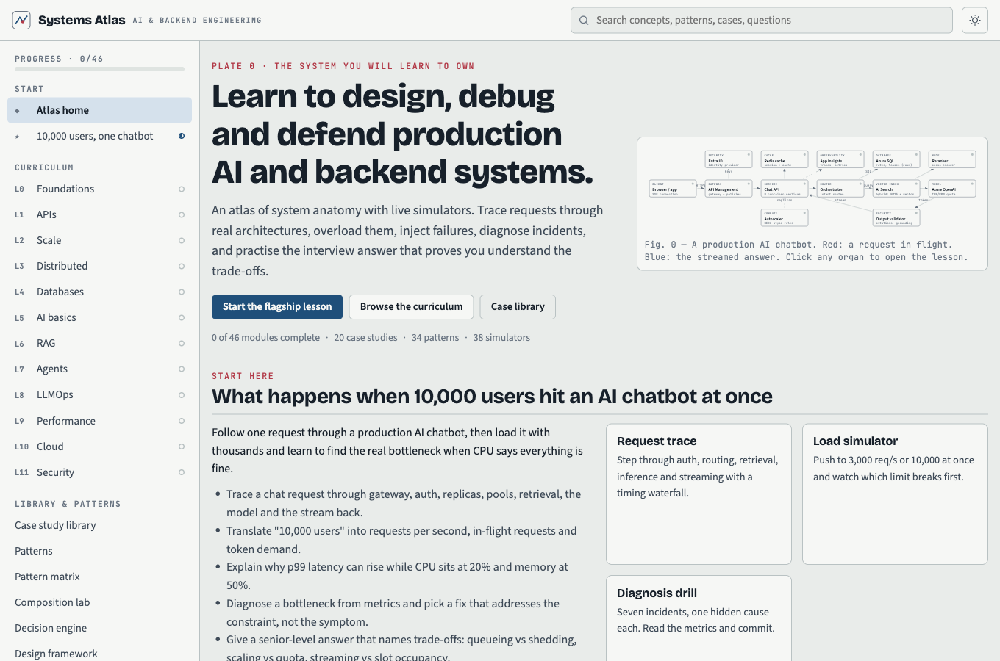
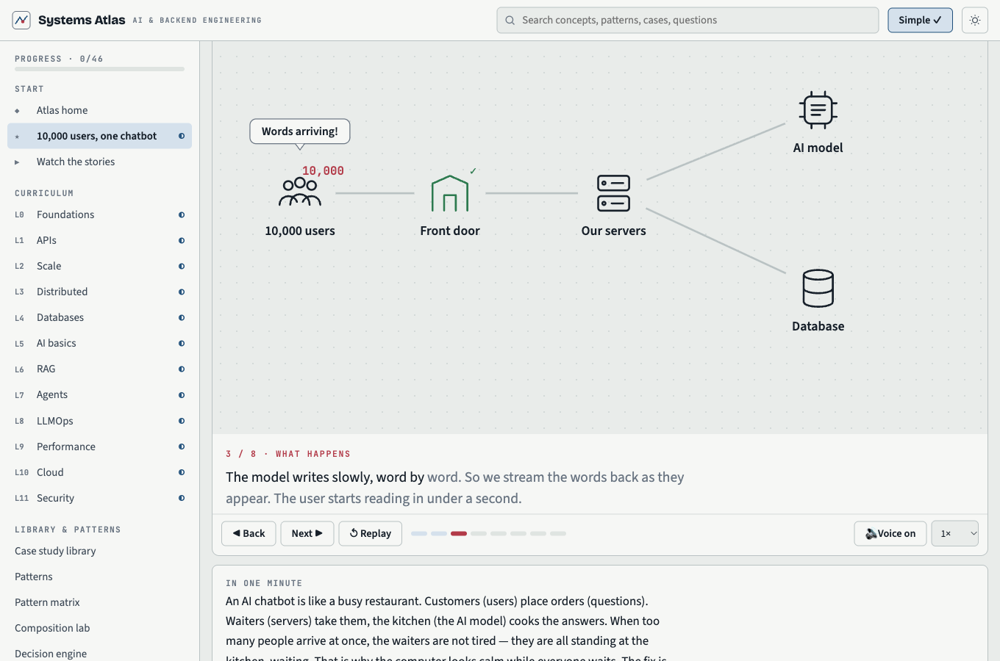
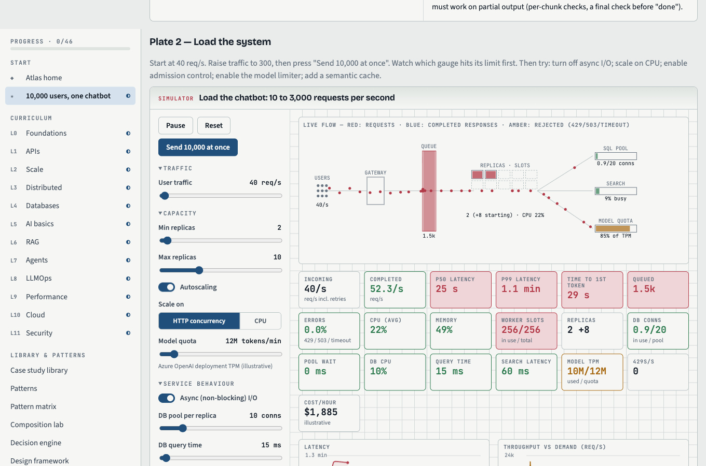

# Systems Atlas

An interactive academy for learning how production AI and backend systems work, from first principles to senior and staff-level interviews.

Instead of reading walls of text, you trace requests through real architectures, overload them, inject failures, diagnose incidents, and practise defending your design decisions.



## What's inside

| Area | What you get |
|---|---|
| **Narrated stories** | Every lesson and case study opens with a short animated story, read aloud in plain English: the problem, what happens, why it breaks, the fix, and what to remember. **Watch mode** plays all 67 back to back. |
| **Flagship lesson** | *What happens when 10,000 users hit an AI chatbot at once.* An animated request trace, a live load simulator, and a diagnosis drill built around the classic puzzle: CPU at 20%, memory at 50%, and p99 latency still climbing. |
| **Curriculum** | 46 lessons across 12 levels: foundations, APIs, scale, distributed systems, databases, AI basics, RAG, agents, LLMOps, performance, Azure cloud, and security. Every concept is explained in plain words first, then precisely. |
| **Simulators** | 38 interactive models: thread pools, connection pools, retries with jitter, consistent hashing, replication lag, B-tree vs table scan, embeddings, HNSW/IVF, chunking, reranking, agent traces, tenant isolation, and more. |
| **Case library** | 20 systems, including Netflix Chaos Monkey, Hotstar-style live streaming, Tatkal-style ticket booking, dark-store delivery, flash sales, Dynamo, Spanner, Kafka/CDC, LLM inference, and four public outage postmortems. Every claim is labelled as *documented*, *industry practice*, or *illustrative*. |
| **Pattern engine** | 34 reusable patterns, a matrix of which case uses which pattern, a composition lab (remove one piece and watch what breaks), 14 anti-patterns, and a decision engine that turns requirements into suggested patterns. |
| **Practice** | 21 engineering scenarios, 66 interview questions across 8 tracks (junior to staff, AI engineer, AI architect, system design, incident response), a 30-second rapid-fire drill, and 8 unseen design problems in mastery mode. |
| **Reference** | A 210-term glossary (hover any underlined term), a concept dependency map, and a review list of the concepts you got wrong. |





## Run it locally

You need nothing but a web browser. There is no build step and no framework.

### Option 1: open the file

Download or clone the repo, then open `index.html` in your browser.

```bash
git clone https://github.com/shaaz1000/systems-atlas.git
cd systems-atlas
open index.html        # macOS
# xdg-open index.html  # Linux
# start index.html     # Windows
```

### Option 2: run a local web server (recommended)

Some browsers restrict pages opened straight from disk. A tiny local server avoids that. Use whichever you have:

```bash
# Node.js (18 or newer)
npm start                       # serves on http://localhost:8080 and opens it

# or Python 3
python3 -m http.server 8080     # then visit http://localhost:8080
```

### Internet connection

The app works offline. With a connection it loads three fonts from Google Fonts; without one it falls back to your system fonts.

## How to use it

1. **Watch first.** Press **▶ Watch the stories** for the plain-English animated version of every chapter, or press play on the story at the top of any lesson.
2. **Then do the flagship lesson.** Press **Start the flagship lesson** on the home page.
3. **Play with every simulator.** Change the sliders, inject a bottleneck, and watch which number moves first. Each simulator lists its assumptions; the numbers are teaching models, not benchmarks.
4. **Pass the knowledge check.** A lesson only counts as complete when you score 4 out of 5. Wrong answers explain the misconception and add the concept to your review list.
5. **Practise out loud.** Scenarios, interview questions and mastery problems hide the answer until you have tried. Then compare with the model answer and the checklist.
6. **Search anything** with the search bar (press `/` to focus it). Use the sun icon to switch between light and dark themes.

**Simple mode** (the *Simple ✓* button in the top bar, on by default) shows only the plain-English explanation of each concept. Use *Show the precise version* under any concept, or switch Simple off, for the full technical detail.

### Notes

- **Voice.** Story narration is pre-recorded with [Kokoro-82M](https://huggingface.co/hexgrad/Kokoro-82M), a free, open-source text-to-speech model (Apache 2.0 licence), so it works offline and needs no account or API key. Captions highlight each word as it is spoken. If you edit a story's text, that line falls back to your browser's built-in voice until you re-record it (see *Re-recording the narration* below).

- **Progress** is saved in your browser (`localStorage`). It stays on that browser and device only. You can reset it from **Review & bookmarks**.
- **AI feedback.** The *Get feedback from Claude* buttons only work when the app is opened as a Claude artifact. When you run it locally, use **Reveal model answer** and grade yourself against the checklist.

## Project structure

```
index.html               Page shell, styles (light and dark themes), script order
js/core.js               Data registries, UI helpers (sliders, charts, diagrams), progress storage
js/lesson.js             Flagship lesson: request trace, load model, diagnosis drill
js/story.js              Story player: animation engine, narration, captions
js/stories-*.js          The 67 narrated stories (one per lesson and case study)
audio/                   Recorded narration (MP3) and audio/voice.js (timings for captions)
js/views.js              Router, pages, search, glossary pop-ups, decision engine (loaded last)
js/data-l0-l3.js         Lessons for Levels 0–3 and their comparisons
js/data-l4-l6.js         Lessons for Levels 4–6 and their comparisons
js/data-l7-l11.js        Lessons for Levels 7–11 and their comparisons
js/data-cases.js         Case study library
js/data-patterns.js      Patterns, glossary, compositions, anti-patterns
js/data-practice.js      Interview questions, scenarios, mastery problems
js/sims-foundations.js   Backend and distributed-systems simulators
js/sims-ai.js            AI, RAG, agent, evaluation, cloud and security simulators
js/sims-cases.js         Case-study simulators and the composition lab
docs/CONTENT-SPEC.md     Data schemas, id lists and writing rules for contributors
docs/STORY-SPEC.md       How to write a story: plain-English rules, characters, animation actions
tools/                   Scripts that export narration text and record it with Kokoro
tests/                   Headless checks (see below)
```

Every page is plain JavaScript that registers content through `window.ACAD` and builds the UI with the helpers in `window.UI`. Navigation uses the URL hash, so links such as `index.html#case-irctc` or `index.html#p-idempotency` open a specific page.

## Contributing

1. Read [`docs/CONTENT-SPEC.md`](docs/CONTENT-SPEC.md). It defines the shape of a lesson, case study, pattern, scenario and simulator, plus the rules for labelling sources.
2. Add or edit content in the matching `js/data-*.js` file, or register a new simulator with `ACAD.registerSim('your-id', fn)`.
3. Run the checks:

```bash
npm install   # installs jsdom for the headless tests
npm test
```

`npm test` runs three checks:

- `check`: syntax-checks every script.
- `test:refs`: fails if any link points at a lesson, case, pattern, simulator or glossary term that doesn't exist.
- `test:stories`: checks every story's characters, animation actions, scene order and sentence length.
- `test:smoke`: opens every page in a headless browser, clicks every button, and fails on any script error or on `NaN` / `undefined` appearing on screen.

### Re-recording the narration

Only needed after you add or edit a story. Requires Python 3.10+; it runs on a laptop CPU (about 5× faster than real time on an Apple M1).

```bash
python3 -m venv .venv && . .venv/bin/activate
pip install "kokoro>=0.9.4" "misaki[en]" soundfile
node tools/export-narration.js > narration.json
python tools/generate-voice.py narration.json   # records only new or changed lines
```

The first run downloads the model (about 330 MB) from Hugging Face. To change the voice, set `ATLAS_VOICE` (for example `am_michael`) and delete `audio/` before running. If espeak-ng complains about a missing `phontab` file, see the comment at the top of `tools/generate-voice.py`.

## Accuracy

- Company claims are labelled **Documented** only when a public source exists, and that source is named. Anything else is labelled **Industry pattern** or **Illustrative**.
- Simulator numbers are illustrative model outputs, never production measurements.
- Cloud limits and quotas change. The content describes how services behave and points to the official documentation instead of quoting exact limits.

Found an error? Open an issue with the page link and a source.
